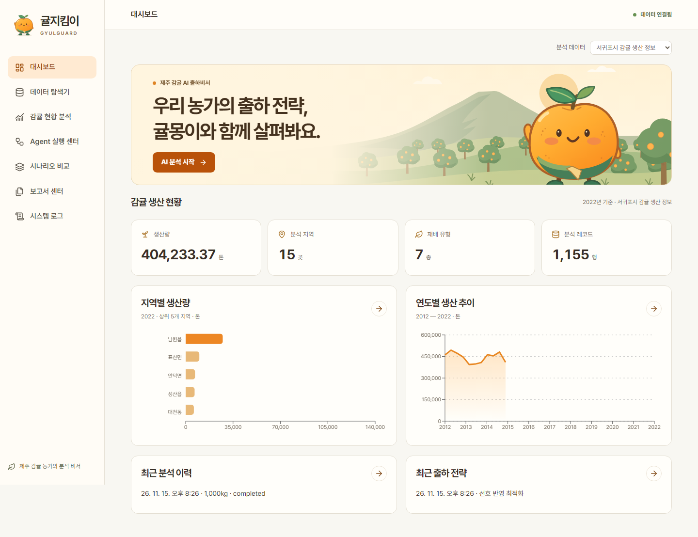
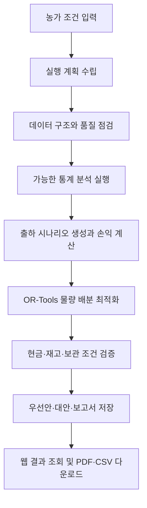

# 🍊 귤지킴이 (GyulGuard)

**제주 감귤 농가가 보유한 물량을 언제, 얼마나 출하할지 비교할 수 있도록 돕는 AI Agent 웹 서비스입니다.**

감귤 1,000kg을 보유한 농가가 오늘 40만 원의 현금을 확보해야 한다면, 지금 몇 kg을 출하하고 나머지는 얼마나 보관하는 편이 좋을까요?

귤지킴이는 이 질문을 **당일 순현금, 전체 예상 순수입, 보관 기한**으로 나누어 계산합니다. 농가가 예상 판매 단가와 비용을 입력하면, AI Agent가 즉시 출하·분할 출하·보관 후 출하 등 여러 일정을 만들고 조건을 만족하는 배분안을 비교합니다. 각 결과에서 **어느 날 몇 kg을 출하하는지**, **비용을 빼고 얼마가 남는지**, **어떤 가정에서 나온 결과인지** 확인할 수 있습니다.



[실제 출하 전략 보고서 PDF](docs/evidence/strategy-demo.pdf) · [사용자 매뉴얼](docs/user_manual.md) · [제출 자료 안내](제출안내.md)

---

## 1. 프로젝트 배경

감귤을 더 오래 보관하면 높은 단가에 판매할 기회가 생기지만, 보관비가 늘어나고 판매 대금을 받는 시점도 늦어집니다. 출하를 여러 번 나누면 필요한 현금을 먼저 확보할 수 있는 대신 회당 출하비가 추가됩니다. 같은 물량과 단가를 가정해도 농가가 오늘 얼마를 필요로 하는지에 따라 선택할 수 있는 일정이 달라집니다.

귤지킴이는 **공식 관측 데이터**와 **농가의 판매 가정**을 구분해 사용합니다.

| 구분 | 사용하는 값 | 서비스에서의 역할 |
|---|---|---|
| 공식 관측 데이터 | 서귀포시 생산량·재배면적, 감귤 당도 실측값, 신고소별 출하량 | 지역·연도·재배유형별 현황을 비교하고 자료의 기간과 범위를 확인 |
| 농가 입력값 | 보유 물량, 현재·미래 예상 단가, 출하비, 보관비, 필요 현금 | 농가별 출하 일정과 예상 순수입을 계산 |
| 도구 계산 결과 | 일자별 출하량, 당일 순현금, 총비용, 위험 조정 점수 | 조건을 충족하는 후보를 선별하고 우선 검토안과 대안을 제시 |

미래 단가는 **가정 기반 시뮬레이션**에 사용합니다. 미래 단가를 비워 두면 현재 단가가 유지된다고 가정하고, 값을 입력하면 현재와 마지막 보관일 사이의 단가를 선형 보간합니다.

## 2. 실제 실행 예시

다음은 프로젝트에 포함된 시연 보고서의 입력 조건입니다.

| 입력 항목 | 시연 값 |
|---|---:|
| 보유 물량 | 1,000kg |
| 현재 예상 판매 단가 | 2,000원/kg |
| 10일 후 예상 판매 단가 | 2,400원/kg |
| 하루 보관비 | 3원/(kg·일) |
| 회당 출하비 | 20,000원 |
| 최대 보관 기간 | 10일 |
| 오늘 필요한 최소 순현금 | 400,000원 |
| 전략 선호도 | 균형형 |

### 출하 전략별 계산 결과

| 출하 전략 | 예상 순수입 | 당일 순현금 | 최소 현금 조건 |
|---|---:|---:|:---:|
| 즉시 전량 출하 | 1,980,000원 | 1,980,000원 | 충족 |
| 2회 분할 출하 | 2,145,000원 | 980,000원 | 충족 |
| 3회 분할 출하 | 2,124,815원 | 648,000원 | 충족 |
| 전량 보관 후 출하 | 2,350,000원 | 0원 | 미충족 |
| 선호 반영 최적화 출하 | **2,252,300원** | **400,000원** | **충족** |

전량을 10일 동안 보관하면 가정한 단가에서 예상 순수입이 가장 높습니다. 하지만 오늘 판매하는 물량이 없어 필요한 현금 40만 원을 확보할 수 없습니다.

OR-Tools가 계산한 균형형 배분은 **오늘 210kg, 10일 후 790kg 출하**입니다. 당일에 200kg만 팔면 매출은 40만 원이지만 출하비를 빼고 나면 38만 원이 남습니다. **출하비까지 고려하면 오늘 출하해야 하는 최소 물량이 210kg**이 됩니다.

```text
당일 순현금 = 210kg × 2,000원/kg − 20,000원
            = 400,000원

총 예상 매출 = (210kg × 2,000원/kg) + (790kg × 2,400원/kg)
             = 2,316,000원

총 출하비 = 2회 × 20,000원 = 40,000원
총 보관비 = 790kg × 10일 × 3원/(kg·일) = 23,700원

예상 순수입 = 2,316,000원 − 40,000원 − 23,700원
            = 2,252,300원
```

여기서 **예상 순수입**은 판매액에서 출하비와 보관비를 차감한 금액입니다. 재배비·인건비를 포함한 농가의 최종 순이익을 계산하려면 해당 비용 자료가 추가로 필요합니다.

## 3. 주요 화면과 기능

| 화면 | 사용자가 할 수 있는 일 |
|---|---|
| **대시보드** | 최근 수록 연도의 생산량, 분석 지역 수, 재배유형 수, 지역별 생산량과 연도별 추이를 확인합니다. 최근 분석을 다시 열거나 새 출하 분석을 시작할 수 있습니다. |
| **데이터 탐색기** | 공식 자료를 선택하거나 CSV를 업로드합니다. 열 이름, 자료형, 인코딩, 결측·중복 수와 실제 데이터 미리보기를 확인합니다. |
| **감귤 현황 분석** | 연도·지역·재배유형으로 범위를 좁혀 생산량을 비교합니다. 선택한 자료에 따라 실제 출하량이나 당도 통계를 확인합니다. |
| **Agent 실행 센터** | 농가의 물량·단가·비용·현금 조건을 입력하고 분석을 실행합니다. 실행 단계, 호출된 도구와 처리 시간을 확인합니다. |
| **시나리오 비교** | 5개 후보의 출하 일정, 비용, 예상 순수입, 당일 순현금과 제약 충족 여부를 비교합니다. 미래 단가 가정을 바꿨을 때의 민감도도 확인합니다. |
| **보고서 센터** | 저장된 분석을 다시 열고, 권장안·대안·데이터 출처·한계가 포함된 PDF 또는 비교용 CSV를 내려받습니다. |
| **시스템 로그** | 실행별 데이터 버전, 재현 파라미터, 도구 호출 결과와 실패 단계를 확인합니다. |

## 4. AI Agent 작동 방식

LangGraph가 7개 실행 단계를 연결합니다. 통계 집계와 손익 계산은 Python 도구가 수행하고, 물량 배분은 OR-Tools가 계산합니다.



| 단계 | 실제 수행 내용 |
|---|---|
| **1. 실행 계획** | 선택한 데이터셋의 열과 지표를 확인해 실행할 분석 도구를 결정합니다. |
| **2. 데이터 점검** | 인코딩, 데이터 기간, 결측·중복, 분석 가능한 지표를 확인합니다. |
| **3. 현황 분석** | 지역별 생산량, 기간별 추이, 당도·등급 등 자료가 지원하는 통계를 집계합니다. |
| **4. 시나리오 생성** | 즉시 출하, 2회 분할, 3회 분할, 지연 출하 일정을 만들고 동일한 비용 조건으로 계산합니다. |
| **5. 물량 최적화** | 보유량과 당일 필요 현금을 제약으로 두고, 선호 전략을 반영한 정수 kg 단위의 배분안을 추가합니다. |
| **6. 결과 검증** | 총 출하량이 보유량과 일치하는지, 보관 한도를 지키는지, 매출과 비용이 맞는지 검산합니다. |
| **7. 보고서 생성** | 조건을 충족하는 후보를 비교해 우선안과 서로 다른 일정의 대안을 저장합니다. 충족하는 후보가 없으면 그 결과도 표시합니다. |

### 로컬 모드와 외부 LLM 모드

- **기본 로컬 모드** — API 키 없이 규칙 기반 플래너로 전체 그래프를 실행합니다. 데이터 분석, 물량 최적화, 검증, 로그 저장, 보고서 다운로드를 사용할 수 있습니다.
- **OpenAI 연동 모드** — `LLM_PROVIDER=openai`로 설정하면 모델이 허용된 도구 목록을 대상으로 Tool Calling을 수행합니다. 결과 설명에서는 검증된 현금·비용·보관 정보 중 먼저 설명할 항목을 구조화된 형식으로 선택합니다.
- **실행 추적** — 각 도구 호출에는 실행 ID, 데이터셋 버전, 입력 조건, 성공 여부, 처리 시간, 결과 또는 오류 유형이 기록됩니다.

[Agent 실행 코드와 실제 프롬프트](docs/agent_sources.md) · [노드별 워크플로](docs/agent_workflow.md)

## 5. 사용한 제주 데이터

| 데이터 | 실제 사용 범위 | 활용 방식 |
|---|---|---|
| 서귀포시 감귤 생산 정보 | 2012~2022년, 15개 읍면동, 7개 재배유형 | 지역·연도·재배유형별 생산 현황 집계 |
| 감귤 당도 실측 자료 | 2020년 11~12월, 44개 측정지점, 유효 관측 177건 | 측정 표본의 평균·최소·최대 당도 확인 |
| 신고소별 노지온주 출하량 | 2022년 11월 25~26일, 제주항·제주공항, 4건 | 두 신고소의 실제 일별 출하량 비교 |

기본 생산 데이터는 **제주데이터허브 원본의 수치 2,832개**를 사용했습니다. 서귀포시 갱신판과 같은 연도·지역·지표끼리 대조해 빈 셀 318개와 2022년 수치 315개를 보완했습니다. 최종 분석 표는 **1,155행**이며, 2022년 서귀포시 생산량 집계는 **404,233.37톤**입니다.

생산량은 연간 지역 통계이고, 당도는 측정지점별 표본이며, 출하량은 특정 신고소의 일별 기록입니다. 세 자료를 각각 독립된 데이터셋으로 제공해 사용자가 조사 단위와 기간을 확인한 후 분석할 수 있습니다.

[제주데이터허브 생산 자료](https://www.jejudatahub.net/data/view/data/1313) · [서귀포시 갱신판](https://www.data.go.kr/data/15048184/fileData.do) · [당도 자료](https://www.data.go.kr/data/15077686/fileData.do) · [출하량 자료](https://www.jejudatahub.net/data/view/data/855)

[데이터 활용 명세 및 이용조건](docs/data_usage.md) · [데이터 사전](docs/data_dictionary.md) · [품질 점검 결과](docs/data_quality.md)

## 6. 출하 최적화 기준

OR-Tools의 CBC 정수 최적화 솔버가 후보 일차별 출하량과 실제 출하 여부를 결정합니다.

- **후보 일차** — 당일, 최대 보관 기간의 중간일, 마지막 보관일입니다. 중간일은 일 단위로 내림하고, 같은 일차가 겹치면 한 번으로 합칩니다.
- **물량 조건** — 모든 출하량은 0 이상의 정수 kg이며, 전체 일정에 배분한 물량의 합은 보유 물량과 같아야 합니다.
- **비용 조건** — 실제로 물량을 출하하는 회차에만 고정 출하비가 발생합니다. 보관비는 각 배치의 물량과 보관 일수를 곱해 계산합니다.
- **현금 조건** — 당일 매출에서 당일 출하비를 차감한 금액이 사용자가 입력한 최소 필요 현금 이상이어야 합니다.
- **선호 전략** — 안정형은 출하 지연에 따른 노출을 더 크게 반영합니다. 균형형은 한 회차에 물량이 집중되는 정도도 반영하며, 수익형은 입력 가정에 따른 예상 순수입을 중심으로 계산합니다.

화면에서는 **예상 순수입**과 **위험 조정 점수**를 구분합니다. 선호 전략에 사용한 가중치는 일정 비교를 위한 설계값이며 실제 가격 변동 확률을 뜻하지 않습니다. [수식과 가중치 상세](docs/optimization_design.md)

## 7. 기술 스택

| 영역 | 기술 |
|---|---|
| 프론트엔드 | React, TypeScript, Vite, React Router, Recharts, Lucide, CSS Modules |
| 백엔드 | Python 3.12, FastAPI, Pydantic 2, SQLAlchemy 2, Alembic |
| 데이터베이스 | PostgreSQL, SQLite |
| Agent | LangGraph, LangChain OpenAI, Tool Calling, Pydantic 구조화 출력 |
| 데이터 분석·최적화 | pandas, NumPy, OR-Tools |
| 보고서 | ReportLab, CSV |
| 테스트·배포 | pytest, Vitest, Ruff, Docker Compose, Nginx |

[의존성 및 오픈소스 목록](docs/dependencies.md)

## 8. 실행 방법

### 방법 A. Windows에서 로컬 시연

Python 환경 관리 도구 `uv`와 Node.js 22, npm을 설치한 후 프로젝트 루트의 PowerShell에서 실행합니다. 처음 실행할 때는 패키지 다운로드를 위한 인터넷 연결이 필요합니다.

```powershell
.\scripts\start-local.ps1
```

실행 후 브라우저에서 **http://127.0.0.1:8130** 을 엽니다. 이 방식은 SQLite를 사용하고, FastAPI가 빌드된 React 화면과 API를 함께 제공합니다.

### 방법 B. 프론트엔드와 백엔드 분리 실행

첫 번째 터미널에서 백엔드를 시작합니다.

```bash
cd backend
uv sync --frozen --python 3.12
uv run python -m uvicorn app.main:app --reload --port 8000
```

두 번째 터미널에서 프론트엔드를 시작합니다.

```bash
cd frontend
npm ci
npm run dev
```

| 접속 대상 | 주소 |
|---|---|
| 개발 웹 화면 | http://localhost:5173 |
| FastAPI 문서 | http://localhost:8000/docs |
| API 상태 확인 | http://localhost:8000/api/health |

### 방법 C. Docker Compose

Docker Engine과 Compose v2가 실행 중인 환경에서 프로젝트 루트에서 실행합니다.

```bash
docker compose up --build -d
docker compose ps
```

접속 주소는 **http://localhost:8080** 입니다. Compose 구성은 PostgreSQL, FastAPI, Nginx 웹 서비스로 이루어져 있습니다.

```bash
docker compose down
```

### 환경변수

기본 로컬 모드는 외부 API 키 없이 사용할 수 있습니다. OpenAI 연동 시 Compose는 루트 `.env`를 읽고, 로컬 개발 서버는 셸 환경변수를 읽습니다. 실제 키가 들어 있는 `.env`는 Git에 커밋하지 않습니다.

| 변수 | 용도 |
|---|---|
| `LLM_PROVIDER` | `local` 또는 `openai` |
| `LLM_MODEL` | 외부 연동 시 사용할 모델 이름. 기본 설정은 `gpt-4o-mini` |
| `OPENAI_API_KEY` | 외부 모델 연동에 사용하는 서버 전용 키 |
| `DATABASE_URL` | SQLAlchemy 데이터베이스 연결 문자열 |
| `POSTGRES_PASSWORD` | Compose PostgreSQL 비밀번호 |
| `DATA_DIR` | 원본 및 전처리 데이터 디렉터리 |
| `CORS_ORIGINS` | 허용할 프론트엔드 Origin 목록 |
| `API_TARGET` | Vite 개발 서버가 요청을 전달할 백엔드 주소 |

[환경변수 예시](.env.example) · [오류 해결 가이드](docs/troubleshooting.md)

## 9. 프로젝트 구조

```text
citrus-guard/
├── backend/
│   ├── app/
│   │   ├── agents/          # LangGraph 워크플로와 모델 연동
│   │   ├── tools/           # 통계 분석, 시뮬레이션, 최적화, 검산
│   │   ├── services/        # CSV 처리와 PDF·CSV 출력
│   │   ├── repositories/    # 데이터 조회
│   │   ├── routers/         # FastAPI 엔드포인트
│   │   ├── models/          # SQLAlchemy 엔티티
│   │   └── schemas/         # Pydantic 입력·출력 모델
│   ├── alembic/             # 데이터베이스 마이그레이션
│   └── tests/
├── frontend/
│   ├── public/              # 귤몽 SVG, 대시보드 일러스트, 서체
│   └── src/                 # 페이지, UI 컴포넌트, API 클라이언트
├── data/
│   ├── raw/                 # 제공기관 원본 CSV
│   ├── processed/           # 정규화된 생산 자료와 품질 점검 결과
│   └── optional/            # 당도·출하량 보조 자료
├── docs/                    # 설계, 데이터 명세, 검증 기록, 시연 결과
├── scripts/                 # 로컬 시연 실행 스크립트
├── .env.example
├── docker-compose.yml
├── 제출안내.md
└── README.md
```

## 10. 테스트와 검증

백엔드 테스트와 정적 검사를 실행합니다.

```bash
cd backend
uv run python -m pytest -q
uv run ruff check app tests alembic
```

프론트엔드 테스트와 프로덕션 빌드를 실행합니다.

```bash
cd frontend
npm ci
npm test
npm run build
```

| 검증 항목 | 확인 결과 |
|---|---|
| 백엔드 테스트 | **20개 통과**. CSV 인코딩·결측, 집계 정확성, 현금 제약, 최적화, Agent 실행, 보고서 생성 등을 검증 |
| 프론트엔드 테스트 | **4개 통과**. 입력 검증, 분석 실행, API 실패 처리, 시나리오 표시와 다운로드 경로 확인 |
| 최적화 정확성 | 작은 재고에서 가능한 배분을 전부 계산하고 3개 선호도별 OR-Tools 결과와 대조 |
| 실제 브라우저 | 7개 화면 이동, 분석 제출, 비교 결과 조회, PDF 다운로드와 모바일 너비 390px 확인 |
| 데이터베이스 | SQLite와 별도 PostgreSQL 환경에서 동일한 시연 입력의 최적화 결과 일치 확인 |
| Docker·외부 LLM | Compose 구성 검사 통과. 검증 환경의 Docker Engine 및 API 키 부재로 컨테이너 기동과 외부 모델 실호출은 미검증 |

[상세 테스트 결과](docs/test_results.md) · [단계별 개발 기록](docs/development_log.md)

## 11. 활용 방안과 한계

**농가 출하 상담**에서는 농가와 상담자가 오늘 필요한 현금이나 예상 단가를 바꿔 보면서 출하 일정이 어떻게 달라지는지 확인할 수 있습니다. **제주빅데이터센터 교육**에서는 참가자가 공식 원본의 지역별 집계를 재현한 뒤, 같은 통계적 배경에서도 농가별 비용과 현금 사정에 따라 서로 다른 전략이 나오는 이유를 실습할 수 있습니다.

기본 생산 자료의 범위는 2012~2022년 서귀포시입니다. 실제 출하량 보조 자료는 두 신고소의 이틀치 관측이므로 제주 전체의 장기 출하 추세를 추정하기에는 범위가 좁습니다. 현재 모형은 저장 중 감모, 등급 변화, 거래처별 수요 한도, 판매 대금의 지급 지연을 반영하지 않습니다.

향후에는 **저장 기간별 감모율, 등급별 실수취가, 실제 정산일**을 확보해 예상 순수입과 현금 유입 시점을 농가의 거래 조건에 더 가깝게 계산하는 것이 목표입니다.

[작품 설명 및 제주빅데이터센터 활용 방안](docs/results.md)
