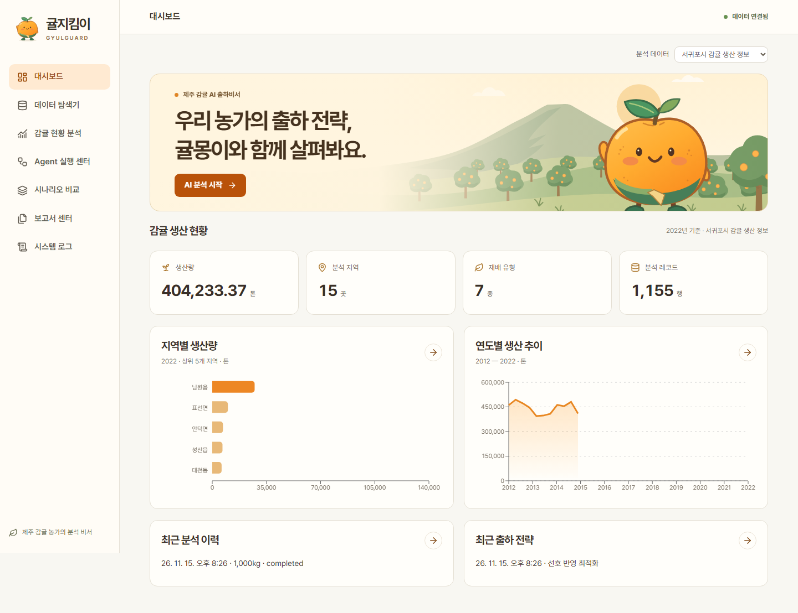

# 귤지킴이 결과 설명자료

### 농가가 해결하려는 문제

보유 감귤을 더 늦게 팔면 높은 단가를 기대할 수 있지만 보관비가 들고 오늘 받을 현금은 줄어든다. 귤지킴이는 농가가 보유량, 예상 단가, 보관 한도, 필요한 현금을 입력하면 조건을 만족하는 출하 일정을 비교할 수 있게 한다.

### Agent 구조와 주요 기능

**실행 계획 → 데이터 점검 → 현황 분석 → 후보 일정 생성 → OR-Tools 배분 → 수치·제약 검증 → 보고서 저장** 순으로 동작한다. 농가는 서귀포 생산 통계와 실측 품질·출하량을 조회하고, 각 출하안의 예상 순수입과 당일 순현금을 비교한다. 검토를 마친 실행은 데이터 버전·입력값과 함께 저장해 PDF 또는 CSV로 내려받을 수 있다. [구현 코드 안내](agent_sources.md)

### 실행 결과

1,000kg을 현재 2,000원/kg, 10일 후 2,400원/kg으로 가정했다. 보관비는 하루 kg당 3원, 출하비는 회당 20,000원, 오늘 필요한 순현금은 400,000원, 전략 선호도는 균형형이다.

| 비교안 | 예상 순수입 | 오늘 순현금 | 현금 조건 |
|---|---:|---:|---|
| 즉시 전량 | 1,980,000원 | 1,980,000원 | 충족 |
| 2회 분할 | 2,145,000원 | 980,000원 | 충족 |
| 3회 분할 | 2,124,815원 | 648,000원 | 충족 |
| 전량 보관 후 출하 | 2,350,000원 | 0원 | 미충족 |
| 선호 반영 최적화 | 2,252,300원 | 400,000원 | 충족 |

최적화 결과는 당일 210kg, 10일차 790kg이다. 오늘 받을 돈은 210×2,000−20,000=400,000원이다. 전량 보관안의 예상 순수입이 더 높아도 현금 제약 때문에 우선 검토 대상에서 제외됐다. [해당 실행의 PDF 보고서](evidence/strategy-demo.pdf)

### 검증 방법과 한계

작은 재고에서 가능한 배분을 모두 계산해 OR-Tools 해와 대조했고, 매출·비용·당일 현금과 보관 한도를 별도로 검산했다. 기존 실행 기록은 pytest 20건 및 Vitest 4건 통과, 브라우저 7개 화면과 PDF 다운로드 확인, SQLite와 PostgreSQL 간 시연 수치 일치를 포함한다. [검증 기록](test_results.md)

생산 자료는 서귀포시의 과거 연간 통계다. 출하량 보조 표본은 이틀치이고 당도 표본은 44개 지점에 한정된다. 모형은 저장 감모, 등급 변화, 거래처 수요나 결제 지연을 반영하지 않는다. Docker 컨테이너 기동 및 외부 LLM 실호출은 기존 검증에서 확인하지 못했다.

### 제주빅데이터센터 활용 방안

- **농가 출하 상담**에서 상담자가 농가와 함께 보유량·필요 현금을 입력하고 가정 단가를 바꿔 본다. 우선안이 달라지는 조건을 확인하고 비교표를 농가에 전달할 수 있다.
- **공공데이터 활용 교육**에서 교육생이 허브 원본과 갱신판을 대조하고 지역·연도 필터로 합계를 재현한다. 이어 같은 물량에 다른 비용을 적용해 공식 관측값과 농가 가정의 차이를 학습할 수 있다.
- **자료 갱신 시 품질 점검**에서 센터 담당자가 신규 자료의 단위·조사 기간·결측을 기존 자료와 대조하고 버전별 결과를 확인할 수 있다. 향후 실수취가와 감모율을 확보하면 별도 표본에서 검증한 뒤 모형에 추가할 수 있다.

위 세 가지는 센터 적용 제안이다. 확인된 실행 범위는 동봉한 로컬 시연과 검증 기록에 기재했다.
